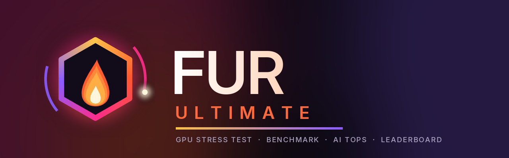
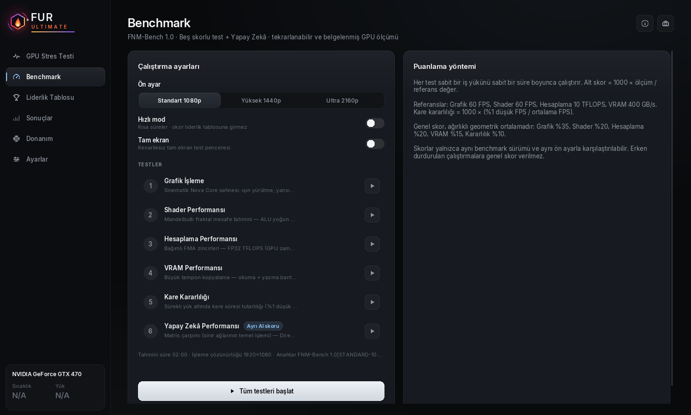
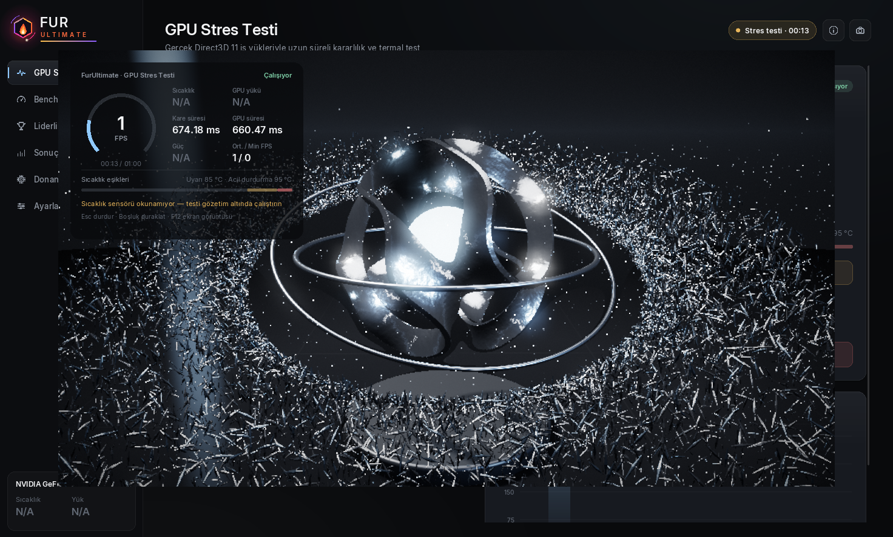
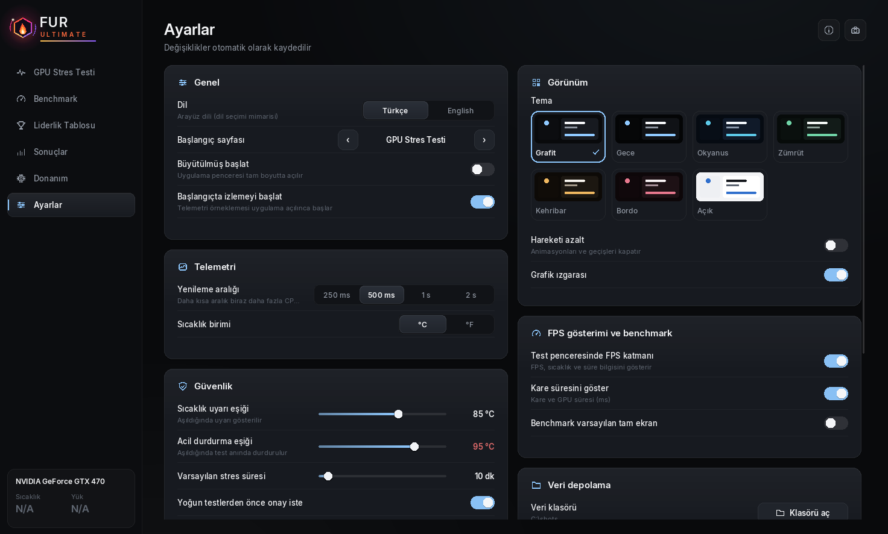

<p align="center">
  
</p>

<p align="center">
  <a href="https://github.com/eren-agalar/FurUltimate/releases/latest"></a>
  
  
  <a href="LICENSE.txt"></a>
</p>

<p align="center">
  <b><a href="#english">English</a></b> · <b><a href="#türkçe">Türkçe</a></b>
</p>

---

<a id="english"></a>

# FurUltimate

**Power. Precision. Performance.** FurUltimate is a native Windows GPU stress test, benchmark and AI-performance tool with an online leaderboard. Every number comes from a real Direct3D 11 / DirectML workload running on your GPU. Nothing is simulated or made up. If a sensor can't be read, the UI, reports and exports show **N/A**.

The interface is in Turkish by default, with English available in Settings.





> Screenshots were taken in a GPU-less development environment (software Direct3D 11), so sensors show N/A and FPS is low.

## Download

Get the latest build from **[Releases](https://github.com/eren-agalar/FurUltimate/releases/latest)**:

| File | What it is |
|---|---|
| `FurUltimate-<version>-Setup.exe` | Installer with Start-menu shortcut and uninstaller (recommended) |
| `FurUltimate-<version>-win64.exe` | Standalone single-file app. No install; just run it |
| `FurUltimate-<version>-win64-portable.zip` | Portable folder with the app, docs and leaderboard server schema |

**Requirements:** Windows 10 1903+ or Windows 11 (64-bit) and a Direct3D 11 GPU. The AI test uses the DirectML that ships with Windows. No extra runtimes are needed.

## Features

| Area | Details |
|---|---|
| **GPU stress test** | ECO / BALANCED / EXTREME / CUSTOM presets, plus resolution, quality and duration (1 / 5 / 10 / 30 / 60 min or continuous). A full live **status panel** sits inside the test window: FPS ring, temperature, load, frame/GPU time, power, limits and warnings. It also has temperature warning and emergency-stop thresholds, TDR protection, and a safe stop if the device is lost. |
| **Benchmark** | 5 scored tests: Graphics, Shader, Compute (TFLOPS), VRAM (GB/s) and Frame Stability. Test 6 is **AI Performance**, with its own AI score and measured vs. theoretical **TOPS**. Every test can also be run on its own. Presets: 1080p / 1440p / 2160p. Scoring is versioned and documented. |
| **Online leaderboard** | Rankings for 1080p, 1440p, 2160p and AI, with player and GPU views and a "My GPU" summary (average, rank, percentile). Joining is opt-in. |
| **Results** | SQLite history, filters, side-by-side comparison (compatible runs only), PDF / JSON / CSV export, screenshots |
| **Hardware** | GPU (IDs, VRAM, memory type, driver, PCIe, API support), CPU, RAM, displays, OS |
| **Settings** | Turkish / English, **7 colour themes**, reduced motion, °C/°F, FPS overlay, safety limits, leaderboard nickname |

### Leaderboard rules
- Only a **full benchmark** (all 5 scored tests) enters the overall boards. AI scores go to the AI boards.
- **Quick mode runs never reach the leaderboard.** Quick mode is for a fast local check; turn it off to compete.
- Only scores that **beat your own previous best** (same preset and GPU) are sent.
- The server recomputes every score from its sub-scores before accepting it. Rate limits and nickname rules apply. See [server/leaderboard/README.md](server/leaderboard/README.md).

## Scoring

- **Sub-scores:** each sub-score = 1000 × measurement / reference. The references are Graphics 60 FPS, Shader 60 FPS, Compute 10 TFLOPS and VRAM 400 GB/s. Frame stability = 1000 × 1% low FPS / average FPS.
- **Overall score:** a weighted geometric mean (Graphics 35 %, Shader 20 %, Compute 20 %, VRAM 15 %, Stability 10 %).
- **AI score:** 1000 × TOPS / 50.
- **Comparability:** scores are only compared within the same benchmark version (`FNM-Bench 1.0`, `FNM-AI 1.0`) and preset.

Details are in [docs/BENCHMARK_METHODOLOGY.md](docs/BENCHMARK_METHODOLOGY.md).

## Building from source

The stack is C++20, CMake and MinGW-w64 (cross-compile from Linux) or MSVC.

**Cross-compile on Linux:**

```bash
sudo apt install mingw-w64 cmake nsis python3-pil
```

```bash
cmake -S . -B build -DCMAKE_TOOLCHAIN_FILE=cmake/toolchain-mingw64.cmake -DCMAKE_BUILD_TYPE=Release
```

```bash
cmake --build build -j
```

**Release build:**

```bash
./tools/build_release.sh
```

The release script produces the installer, the standalone exe, the portable ZIP and `SHA256SUMS.txt` in `dist/`.

**Windows (Visual Studio 2022):**

```bash
cmake -S . -B build -G "Visual Studio 17 2022" -A x64
```

```bash
cmake --build build --config Release
```

**Tests:** run `build\aether_tests.exe` on Windows, or `wine build/aether_tests.exe` on Linux. The suite has 25 tests: score formulas, exports, database, settings, themes, shader compilation, stress cancellation, device-lost recovery, an end-to-end benchmark, DirectML worker isolation and leaderboard client integration.

### Your own leaderboard server
Source builds have no leaderboard until you point them at a server. To set one up:
1. Create a free Supabase project.
2. Run [`server/leaderboard/schema.sql`](server/leaderboard/schema.sql).
3. Put the project URL and **anon** key in a `leaderboard.json` file at the repo root. It is git-ignored, and CMake embeds it into the exe.

Full guide: [server/leaderboard/README.md](server/leaderboard/README.md).

## Tech
- **Direct3D 11:** ray-marched hero scene, procedural geometry, compute shaders, VRAM streaming, tiled GEMM
- **DirectML + Direct3D 12:** FP16 GEMM on Tensor Cores where available. It runs in an isolated worker process.
- **UI:** a custom Direct2D / DirectWrite interface (Inter font embedded)
- **Telemetry:** NVIDIA NVML, AMD ADL, D3DKMT, PDH
- **Data and network:** SQLite, a custom PDF writer, WinHTTP + Supabase/PostgREST
- **Packaging:** a single statically linked `FurUltimate.exe`

## Safety
Stress tests run your GPU at high power and temperature. FurUltimate has configurable warning and emergency-stop thresholds, TDR protection, capped VRAM allocation and time-limited presets, and **Esc always stops a test immediately**. It still can't protect hardware with poor cooling or an unstable overclock. Use it at your own risk. Scores are not a hardware diagnosis.

## License
[MIT](LICENSE.txt). Third-party components keep their own licenses: [THIRD_PARTY_NOTICES.txt](THIRD_PARTY_NOTICES.txt).

---

<a id="türkçe"></a>

# FurUltimate (Türkçe)

**Power. Precision. Performance.** FurUltimate, Windows için yerel bir GPU stres testi, benchmark ve yapay zekâ performansı uygulamasıdır; çevrimiçi liderlik tablosu da vardır. Her değer, ekran kartınızda çalışan gerçek bir Direct3D 11 / DirectML iş yükünden gelir. Hiçbir değer simüle edilmez veya uydurulmaz. Bir sensör okunamıyorsa arayüz, raporlar ve dışa aktarımlar **N/A** gösterir.

Arayüz varsayılan olarak Türkçedir; Ayarlar'dan İngilizceye geçilebilir.



## İndirme

Son sürümü **[Releases](https://github.com/eren-agalar/FurUltimate/releases/latest)** sayfasından indirin:

| Dosya | Açıklama |
|---|---|
| `FurUltimate-<sürüm>-Setup.exe` | Başlat menüsü kısayolu ve kaldırıcı içeren kurulum paketi (önerilen) |
| `FurUltimate-<sürüm>-win64.exe` | Tek dosyalık uygulama. Kurulum gerekmez, doğrudan çalıştırılır |
| `FurUltimate-<sürüm>-win64-portable.zip` | Uygulama, belgeler ve liderlik sunucusu şemasını içeren taşınabilir klasör |

**Gereksinimler:** Windows 10 1903+ veya Windows 11 (64-bit) ve Direct3D 11 destekli bir ekran kartı. AI testi, Windows ile gelen DirectML'i kullanır. Ek bir çalışma zamanı kurmak gerekmez.

## Özellikler

| Alan | İçerik |
|---|---|
| **GPU stres testi** | ECO / BALANCED / EXTREME / CUSTOM ön ayarları; çözünürlük, kalite ve süre (1 / 5 / 10 / 30 / 60 dk veya sürekli) seçimi. Test penceresinin içinde tam bir canlı **durum paneli** bulunur: FPS halkası, sıcaklık, yük, kare/GPU süresi, güç, eşikler ve uyarılar. Ayrıca sıcaklık uyarı ve acil durdurma eşikleri, TDR koruması ve cihaz kaybında güvenli durdurma vardır. |
| **Benchmark** | 5 skorlu test: Grafik, Shader, Hesaplama (TFLOPS), VRAM (GB/s) ve Kare Kararlılığı. 6. test **Yapay Zekâ Performansıdır**; kendi AI skoru vardır ve ölçülen ile teorik **TOPS** değerlerini gösterir. Her test tek başına da çalıştırılabilir. Ön ayarlar: 1080p / 1440p / 2160p. Puanlama sürümlü ve belgelenmiştir. |
| **Çevrimiçi liderlik tablosu** | 1080p, 1440p, 2160p ve Yapay Zekâ sıralamaları; oyuncu ve ekran kartı görünümleri; "Benim kartım" özeti (ortalama, sıra, yüzdelik dilim). Katılım isteğe bağlıdır. |
| **Sonuçlar** | SQLite geçmişi, filtreleme, iki sonucu karşılaştırma (yalnızca uyumlu çalıştırmalar), PDF / JSON / CSV dışa aktarma, ekran görüntüsü |
| **Donanım** | GPU (kimlikler, VRAM, bellek türü, sürücü, PCIe, API desteği), CPU, RAM, ekranlar, işletim sistemi |
| **Ayarlar** | Türkçe / English, **7 renk teması**, hareket azaltma, °C/°F, FPS katmanı, güvenlik eşikleri, liderlik tablosu takma adı |

### Liderlik tablosu kuralları
- Genel panolara yalnızca **tam benchmark** (5 skorlu testin tamamı) girer. AI skorları AI panolarına gider.
- **Hızlı mod ile alınan sonuçlar liderlik tablosuna hiç gönderilmez.** Hızlı mod yerel bir ön kontrol içindir; sıralamaya girmek için kapatın.
- Yalnızca **kendi önceki rekorunuzu geçen** skorlar (aynı ön ayar ve ekran kartı) gönderilir.
- Sunucu her skoru kabul etmeden önce alt skorlardan yeniden hesaplar. Gönderim sıklığı ve takma ad kuralları uygulanır. Ayrıntılar: [server/leaderboard/README.md](server/leaderboard/README.md).

## Puanlama

- **Alt skorlar:** her alt skor = 1000 × ölçüm / referans. Referanslar: Grafik 60 FPS, Shader 60 FPS, Hesaplama 10 TFLOPS, VRAM 400 GB/s. Kare kararlılığı = 1000 × %1 düşük FPS / ortalama FPS.
- **Genel skor:** ağırlıklı geometrik ortalama (Grafik %35, Shader %20, Hesaplama %20, VRAM %15, Kararlılık %10).
- **AI skoru:** 1000 × TOPS / 50.
- **Karşılaştırılabilirlik:** skorlar yalnızca aynı benchmark sürümü (`FNM-Bench 1.0`, `FNM-AI 1.0`) ve aynı ön ayar içinde karşılaştırılır.

Ayrıntılar: [docs/BENCHMARK_METHODOLOGY.md](docs/BENCHMARK_METHODOLOGY.md).

## Kaynaktan derleme

Kullanılan araçlar: C++20, CMake ve MinGW-w64 (Linux'tan çapraz derleme) veya MSVC.

**Linux üzerinde çapraz derleme:**

```bash
sudo apt install mingw-w64 cmake nsis python3-pil
```

```bash
cmake -S . -B build -DCMAKE_TOOLCHAIN_FILE=cmake/toolchain-mingw64.cmake -DCMAKE_BUILD_TYPE=Release
```

```bash
cmake --build build -j
```

**Sürüm paketi:**

```bash
./tools/build_release.sh
```

Bu komut `dist/` altında kurulum paketini, tek exe'yi, taşınabilir ZIP'i ve `SHA256SUMS.txt` dosyasını üretir.

**Windows (Visual Studio 2022):**

```bash
cmake -S . -B build -G "Visual Studio 17 2022" -A x64
```

```bash
cmake --build build --config Release
```

**Testler:** Windows'ta `build\aether_tests.exe`, Linux'ta `wine build/aether_tests.exe` ile çalıştırılır. 25 test vardır: skor formülleri, dışa aktarma, veritabanı, ayarlar, temalar, shader derleme, stres testi iptali, cihaz kaybından kurtarma, uçtan uca benchmark, DirectML alt süreç yalıtımı ve liderlik tablosu istemci entegrasyonu.

### Kendi liderlik sunucunuz
Kaynaktan derlenen sürümde, bir sunucu tanımlanana kadar liderlik tablosu yoktur. Kurmak için:
1. Ücretsiz bir Supabase projesi açın.
2. [`server/leaderboard/schema.sql`](server/leaderboard/schema.sql) dosyasını çalıştırın.
3. Proje adresini ve **anon** anahtarını depo kökünde bir `leaderboard.json` dosyasına yazın. Bu dosya git'e eklenmez; CMake onu exe'nin içine gömer.

Ayrıntılı rehber: [server/leaderboard/README.md](server/leaderboard/README.md).

## Belgeler
- [Kullanıcı kılavuzu](docs/USER_GUIDE.md)
- [Benchmark yöntemi](docs/BENCHMARK_METHODOLOGY.md)
- [Mimari](docs/ARCHITECTURE.md)
- [Donanım test prosedürü](docs/HARDWARE_TEST_PROCEDURE.md)
- [Bilinen sınırlamalar](docs/KNOWN_LIMITATIONS.md)
- [Sürüm notları](RELEASE_NOTES.md)

## Güvenlik
Stres testleri ekran kartını yüksek güç ve sıcaklıkta çalıştırır. FurUltimate'te ayarlanabilir uyarı ve acil durdurma eşikleri, TDR koruması, sınırlı VRAM kullanımı ve süre sınırlı ön ayarlar vardır; **Esc tuşu testi her zaman anında durdurur**. Yine de yetersiz soğutma veya kararsız hız aşırtma olan bir donanımı koruyamaz. Kullanım riski size aittir. Skorlar bir donanım arızası teşhisi değildir.

## Lisans
[MIT](LICENSE.txt). Üçüncü taraf bileşenler kendi lisanslarına tabidir: [THIRD_PARTY_NOTICES.txt](THIRD_PARTY_NOTICES.txt).
